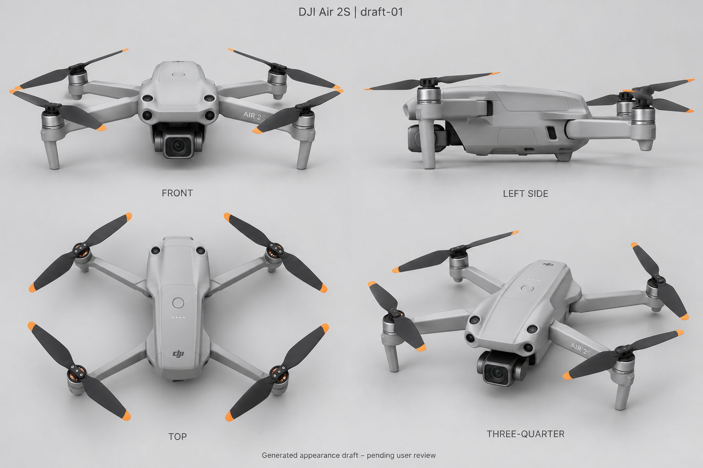

# AeroSim 1.25 · DJI Air 2S 外观审核稿

## draft-01 · pending_user

本轮于 2026-10-11（America/Los_Angeles）用内置 `image_gen` 一次生成，未使用 CLI/API fallback，也未定向修订。已复制到项目目录，并实际通过 `view_image` 检查。它是 1536 × 1024 的四视图生成位图，不是官方产品照、精确 CAD、运行网格、UV、LOD、碰撞器或最终 PBR 材质。

- 机型：`dji-air-2s`，不是 Mavic Air 2、Air 3 或 Air 3S。
- 稿件：`draft-01`，状态 `pending_user`。
- PNG SHA-256：`05f07935cd8a1f60890d082a297ae1e13145f0633afb8e9e8060d56b0f580d2f`。
- 完整精确提示词：[air-2s-draft-01.prompt.txt](../assets/v125-art/air2s/air-2s-draft-01.prompt.txt)。提示词 SHA-256：`6d554e8a94b8e48a150daa4367196d6add1f9c5dfb440c9c04bcdb51ec633588`。
- 审核记录：[review-drafts.json](../assets/v125-art/air2s/review-drafts.json)。

## 生成前实际核对的官方资料

1. [DJI Air 2S 官方入口](https://www.dji.com/air-2s) 实际浏览时重定向至 [DJI 官方支持页](https://www.dji.com/sg/support/product/air-2s)。页面明确显示 Air 2S；放大观察页面上的 800 × 800 展开前视产品图，核对浅灰壳、黑桨橙尖、前臂短支脚、下挂单摄云台和机鼻前/上方四个感知窗口。页面资源地址为 `https://www-cdn.djiits.com/cms/uploads/ef24c60a64def7a99d0aec28625ac5a3.png`，在浏览器实际看图；该 CDN 未加入现有审核生成器来源白名单，因此 manifest 记录其官方页面上下文，不扩大白名单。
2. [官方 Air 2S 下载入口](https://www.dji.com/air-2s/downloads) 与 [用户手册 v1.2](https://dl.djicdn.com/downloads/DJI_Air_2S/20240528UM/DJI_Air_2S_User_Manual_v1.2_ENV.pdf)。浏览工具对 PDF 提示文件过大，随后从相同官方地址下载到临时参考目录，用 `pdftoppm` 渲染并实际观察 PDF 第 7、8、9 页（印刷页 6、7、8）。第 7 页核对单颗一英寸 CMOS 相机说明，第 8 页核对四臂展开与桨叶安装，第 9 页核对 Aircraft Diagram 的相机、前/后/上/下感知与支脚位置。该 PDF SHA-256 为 `eafabacd55f5f2b5b4cbb956465b3fcb56ef11fc7acfd6048cf88e12fccdce78`；参考 PDF 与渲染页未作为项目原创图稿提交。
3. [官方商店 Air 2S 翻新整机页面](https://store.dji.com/product/dji-air-2s-refurbished-unit?vid=115491) 的说明再次核对单颗一英寸相机；实际在浏览器观察其 [640 × 640 折叠底部机身照片](https://se-cdn.djiits.com/tpc/uploads/in_the_box/cover/fb22e7aa522c3f9e0f4296f5be6844e0%40retina_small.png)。照片的电池舱/底部布局可作局部参考，不将翻新套装另算一种无人机型号。

官方照片仅用于人工视觉核对，没有下载为本项目效果图，也没有传入生成工具作为图像输入。本次新图使用保存的完整文字提示词生成。另看过商店 240 × 240 套装/质保拼图，但其飞机比例过小，不作为细节正确性的证明。未声称查看所有官网产品图或实物。

## 实际看图结论与保留风险

正面、左侧、俯视、前左三分之四四个面板已经呈现同一类浅灰折叠四旋翼轮廓、展开四臂、四个电机、黑色两叶桨橙尖及单摄云台；正面与三分之四保留四个独立的前/上感知窗口，没有画成 Air 3 双摄或 Mavic 4 Pro 球形三摄。

仍需用户逐面确认及后续美术修正：

- 相机外壳与两侧支架比官方前视照片显得厚重、暴露；镜头玻璃和云台连接比例尚未精确对齐。
- 感知窗口大小、壳体凹槽、位置的投影在四视图中可能漂移；俯视中下方前视窗口被遮挡，不意味着已经核对了完整传感器集合。后视位置未作标定。
- 侧视、俯视带轻微透视；没有工程尺度，机臂铰链、支脚长度、桨距和电机比例不能直接用作准确建模蓝图。
- 四视图没有完整展开底部下视、红外、补光和接口细节，也没有独立后视图；看过底部官方照片不等于本稿已准确呈现底部。
- 只有生成位图与人工局部观察，没有真实网格跨视图一致性、实物测量或可飞 3D 资产测试。

用户尚未单独批准 `dji-air-2s` / `draft-01` / 上述 PNG 散列。必须由用户针对这份具体稿件确认并保存记录；根负责人、美术或自动化不能替代。确认前不接入 Unity 正式选机、正式飞行代码或最终 3D 资产；变更确认过的外观后重新审核。

本美术成员只写 `assets/v125-art/air2s/` 与本文件，未修改原 23 张概念图、其他机型、PRD、目录、审核 HTML、生成器、Unity 或 Git。由根负责人整合画廊与产品文档、独立验证并提交推送。
