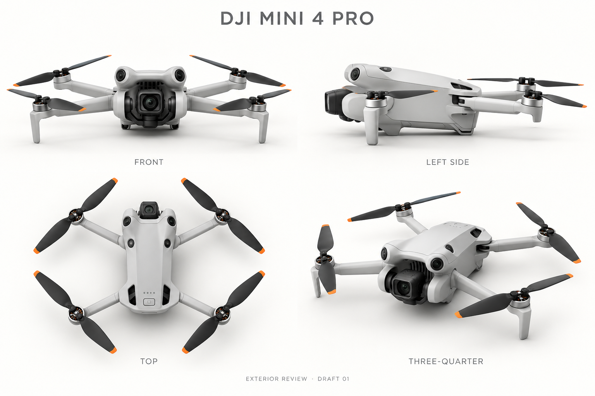

# AeroSim 1.25 现代消费机型美术审核稿

## DJI Mini 4 Pro · draft-01

外观状态：`pending_user`。本轮通过内置 image_gen 生成一张 1536 × 1024 四视图概念位图，已实际打开生成结果检查。四视图为正面、侧面、俯视、前左三分之四；用户尚未对本机型、本稿版本与图像散列作出确认。

- 机型 ID：`dji-mini-4-pro`
- 图像 SHA-256：`5d41de5113d0a0da95109807d479b4392c28052adb802383278db6deb90b360d`
- 稿件记录：[review-drafts.json](../assets/v125-art/current/review-drafts.json)
- 完整生成提示词：[mini-4-pro-draft-01.prompt.txt](../assets/v125-art/current/mini-4-pro-draft-01.prompt.txt)
- 生成方式：内置 image_gen；未使用 CLI/API fallback。
- 类型：`generated_review_bitmap`，摄影级 3D 式效果稿；没有产生实际网格、UV、LOD、碰撞器或最终 PBR 材质。

## 生成前核对的官方资料

检索/观察日期：2026-10-09（America/Los_Angeles）。

1. [DJI Mini 4 Pro 官方页面](https://www.dji.com/mini-4-pro)：机型定位与多向视觉传感器信息。
2. [DJI Mini 4 Pro 官方规格](https://www.dji.com/mini-4-pro/specs)：对应的官方机型，不把 Air/Mavic 的双、三摄系统套用到本机型。
3. [DJI Mini 4 Pro 官方下载页](https://www.dji.com/mini-4-pro/downloads)：v1.4 手册入口。
4. [官方用户手册 v1.4](https://dl.djicdn.com/downloads/DJI_Mini_4_Pro/20240627/DJI_Mini_4_Pro_User_Manual_en.pdf)：本地渲染并实际观察第 11 页展开步骤、第 14 页 Aircraft Diagram；生成时将这两页作为结构参考输入。
5. [官方 DJI Store 页面](https://store.dji.com/product/dji-mini-4-pro)：实际浏览产品照片。
6. [官方折叠俯视产品图](https://se-cdn.djiits.com/tpc/uploads/in_the_box/cover/f255909c0783c37eb297b38f96b21729%40retina_small.png)：实际在浏览器观察灰色外壳、黑桨橙尖、机身上方感知窗口和按键/指示灯布局。远程图仅用于观察，没有作为本项目生成资产冒充原创。

## 实际看图后的检查与风险

大轮廓已呈现小型浅灰折叠四旋翼，四个展开机臂、四个电机、黑色两叶桨橙色尖端、单云台相机及前臂短支脚，没有混用 Air 3 双摄或 Mavic Pro 三摄，也没有额外护桨和行业载荷。

待修正/核对项保留在审核画廊中：

- 云台相机两侧支架偏厚，前脸通风缝被加强；真实形状和比例还需高清官方照片逐面核对。
- 感知窗口的大小、数量与投影位置在四个视图之间仍可能有生成漂移。官方第 14 页没有提供全正交标定视图，不能据此宣称精确复刻。
- 侧视图带轻微透视，四视图没有实际标定尺寸；本图适合外观讨论，不能直接作为网格建模蓝图。
- 底部下视、红外感知与补光布局在这张四视图中未完整展示，后续建模前必须另查底部。
- 机身铰链、传感器玻璃、桨叶安装螺丝和相机铭文未完成逐像素精度验收。

因此本稿仅进入用户审核队列。用户需针对 `dji-mini-4-pro`、`draft-01` 和上述 SHA-256 逐机型确认；由负责人保存确认记录。确认前不进入正式可飞选机菜单或最终 3D 资产。改动已确认外观后重新确认。

本轮没有修改 Unity、原 23 张设计图或其他美术目录；由根负责人整合产品文档、审核画廊和 GitHub 提交推送。
