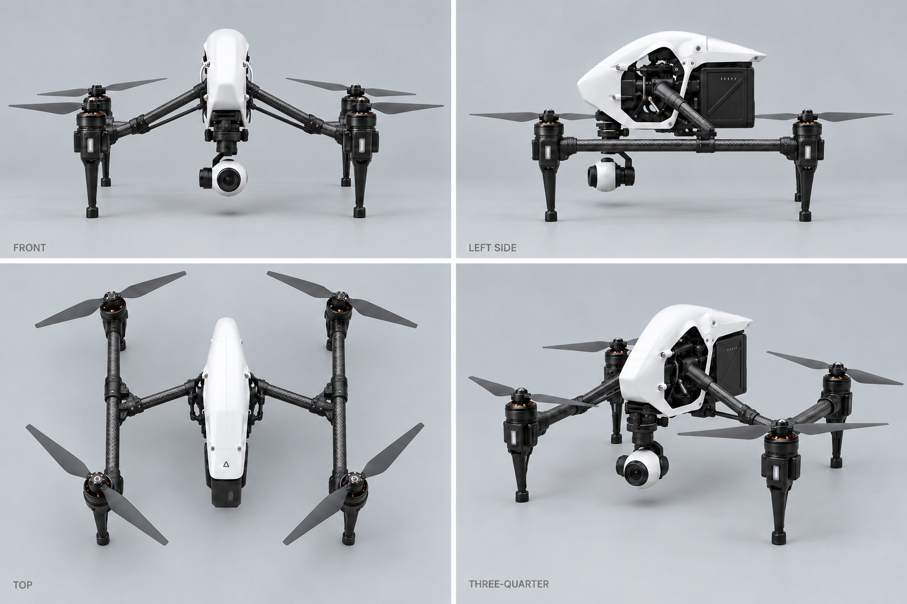
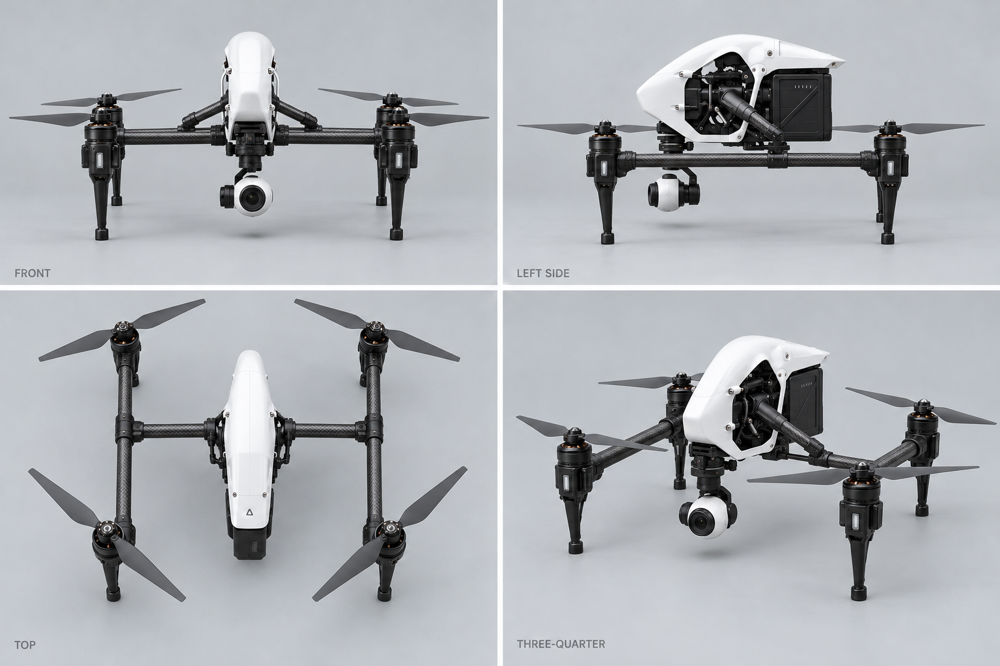

# AeroSim 1.25 经典电影机型美术：DJI Inspire 1 原版 X3 审核稿

日期：初稿 2026-10-09；本轮修订 / 冻结 2026-10-10（America/Los_Angeles）

产品线：DJI 目录 / 经典电影机型 3D 美术

机型 ID：`dji-inspire-1`（与冻结目录 `assets/catalog-v125/dji-aircraft.json` 一致）

当前稿件：`draft-03`（`draft-01`、`draft-02` 原 PNG 与提示词均保留为历史；当前清单只保留同机型的一条 `draft-03`）

外观状态：`pending_user`。尚未获得用户对本机型、本稿版本与图像散列的单独确认。

## 稿件用途与边界

本稿是内置 image_gen 真实生成的摄影级 3D 风格**外观审核位图**，不是 DJI 官方照片，不是可运行网格、CAD、UV / LOD / 碰撞器或最终 PBR 材质。仅可进入外观审核画廊；不得进入正式选机飞行或最终 3D 资产。

目标限定为 **2014 原版白壳 DJI Inspire 1 + Zenmuse X3 FC350**，机臂降下的着陆模式。不是 Inspire 1 V2.0、Pro、RAW、X5 / X5R、黑版、Inspire 2 或 Inspire 3。目标为同一构型四视图；本轮已改善初稿径向 X 臂与侧视纵杆的粗拓扑冲突，但**没有证明严格四视图一致或机械精度通过**。

## 当前审核稿



- 图像：`assets/v125-art/inspire/inspire-1-x3-draft-03.png`。
- 尺寸 / 格式：1536 × 1024，8-bit RGB PNG；SHA-256：`94a2245bd26a4bfdd930ea0b6d51f596e9bf4d1459f88861329a4c4e695e4491`。
- 视图标签：FRONT、LEFT SIDE、TOP、THREE-QUARTER；左侧视鼻朝左，顶视目标鼻朝上。
- 当前审核清单：[review-drafts.json](../assets/v125-art/inspire/review-drafts.json)；只有 `dji-inspire-1` / `draft-03` 一条当前 `pending_user`，不是三个可重复确认的目录项。
- 实际提示词：[draft-02 编辑提示词](../assets/v125-art/inspire/inspire-1-x3-draft-02.prompt.txt)、[draft-03 聚焦提示词](../assets/v125-art/inspire/inspire-1-x3-draft-03.prompt.txt)。保留的 [draft-01 提示词](../assets/v125-art/inspire/inspire-1-x3-draft-01.prompt.txt) 未修改。
- 执行方式：本轮两次内置 `image_gen` 编辑。第一次以本地 `draft-01` 为 target 生成 `draft-02`；第二次以实际查看后的本地 `draft-02` 为 target 生成 `draft-03`。两次均将已实际观看的官方手册第 9 页 / 第 7 页作为结构 / 细节支持输入；不复制官方照片、手册文字、版面或线稿为原创。
- 本轮使用 `imagegen` 的非覆盖编辑、输入角色和不变量约束；使用 `pdf` 渲染观察官方手册。产物均从内置工具实际返回的 `generated_images` 路径复制到本目录，实际用 `view_image` 查看仓库 PNG，使用 `file` / `sips` 核验格式尺寸及 `shasum -a 256` 绑定真实字节。没有 CLI / API fallback、Python 修图、SVG / 假 PNG 或可运行网格。

### draft-03 实际看图后的严格自查

以下是美术自查，不是独立 QA，更不替代用户确认。

| 检查项 | 实际观察 / 边界 |
| --- | --- |
| 原版白壳 / 单电池 / X3 目标 | 白色曲面壳、单黑色后电池、小型白色单镜头相机保留；未看到双电池、鼻部 FPV、黑版壳、X5 可换镜头或 RAW SSD。不能据此证明每个零件是原版。 |
| 纵杆粗拓扑 | TOP 现在显示左右两条连续前后纵杆，连接各自前 / 后电机；LEFT SIDE 和 THREE-QUARTER 也能看到连续纵杆，不再是初稿 TOP 的四条径向 X 臂。这是可见的粗拓扑改善，不是全几何通过。 |
| 正视下降机构 | draft-02 的粗水平跨机身横杆在 draft-03 消失，改为从高机身向外下降的左右碳杆与较细下连杆；较接近官方正视结构。准确枢轴位置、连杆数量 / 落点 / 角度尚未逐部件核验。 |
| 四视图一致性 | **未通过严格标定**：修订时 TOP 中央连接由水平变成略斜，位置发生变化；三分之四及侧视机构落点、下连杆走向不能证明属于同一标定网格。LEFT SIDE 未清楚显示完整的下部连杆。 |
| 四桨 / 四脚 / 遮挡 | TOP 与 THREE-QUARTER 可辨四电机、四双叶桨和四脚；正 / 侧视有自然遮挡，没有人为拆开远侧。没有明显新增桨 / 相机或裁切桨尖。自紧桨黑 / 灰帽分配、电机细节、足底接地和精确间距未量测。 |
| 着陆脚 | 仍偏直、偏厚，近侧脚像长尖片加圆形橡胶底；官方倾斜 / 三角细支撑轮廓未准确还原。不宣称着陆足结构或形态一致。 |
| X3 云台 / 安装板 | 前 / 侧 / 三分之四单镜头方向可读为朝前；相机壳仍偏球状、黑支架和上部偏航组件偏厚。原版小型连接与 V2.0 X5 减振板区分未逐零件证明，不能视为最终 X3 结构。 |
| 投影 / 真实比例 | TOP 仍可看到较长脚部和透视倾斜；FRONT / LEFT SIDE 也非标定正交，四面没有共同尺寸标尺。无实机、CAD 或摄影测量校验，不能用于 1:1 建模蓝图。 |
| 微小硬件 / 最终资产 | LED 位置 / 色彩、3510 电机、自紧桨帽、接口、线缆、螺丝、电池文字、底部视觉 / 超声传感器、背 / 底视未完整核对。没有网格、LOD、UV、碰撞器、变形动画或最终材质。 |

本轮按负责人限定做两次编辑后冻结。后续候选须继续解决枢轴 / 下连杆、细长脚、原版 X3 连接和一致投影，不用继续生成或更换版本号掩盖缺陷。本美术冻结时独立 QA 和逐机型用户确认仍未发生，后续 QA 由负责人另行记录。

### 保留的中间审核稿 draft-02



- 原字节保留：`assets/v125-art/inspire/inspire-1-x3-draft-02.png`，1536 × 1024 RGB PNG。
- SHA-256：`d7ee1ee8d9ae193f520618a688042a6f12db0449264c587a167b56d819a3fc60`。
- 已实际发现并保留的失败：TOP 改为双纵杆 H 结构，但 FRONT 出现粗水平跨全机身横杆，下降碳杆只伸到半幅，与官方前视下降机构不一致；脚、云台仍偏厚。因此没有确认或覆盖该稿，第二次另存 `draft-03`。
- 状态仍为历史 `pending_user` / 未通过精确结构，当前审核入口不对该版本重复建立当前记录。

## 历史初稿 draft-01（保持原字节与失败记录）


- 图像：`assets/v125-art/inspire/inspire-1-x3-draft-01.png`
- 尺寸 / 格式：1536 × 1024，RGB PNG。
- SHA-256：`9ca8f89268abcb28b73a2e3b910a5838bdc034b0188ab01b6bf0a6a08380f3a2`。
- 视图标签：FRONT、LEFT SIDE、TOP、THREE-QUARTER；目标左侧视鼻朝左，顶视鼻朝上。
- 紧凑审核清单：[review-drafts.json](../assets/v125-art/inspire/review-drafts.json)。
- 提示词文件：[inspire-1-x3-draft-01.prompt.txt](../assets/v125-art/inspire/inspire-1-x3-draft-01.prompt.txt)。
- 执行方式：内置 `image_gen`，一次文字生成；无 CLI / API fallback。
- 实际产物已从内置工具返回的 `generated_images` 路径复制到仓库目录，并使用 `view_image` 打开仓库中的实际 PNG 检查；没有用占位图或手画结构图替代生成。
- 生成前观看的官方参考没有作为图片输入传入此次生成；提示词使用观察后的文字约束。

## 官方依据与版本区分

初稿检索 / 观察日期：2026-10-09（America/Los_Angeles）。本轮 2026-10-10 重开发布说明及旧产品页，并下载官方 CDN 手册，渲染、实际完整查看第 6–9 页；发布活动、支持 / FAQ、X3 页面是保留的初稿来源，没有声称本轮重新逐页核对。只采用 DJI 官方主源及官方 CDN 手册；第三方转载不作为依据。

| 官方来源 | 核对内容（按上文区分初稿 / 本轮日期） |
| --- | --- |
| [DJI 2014 Inspire 1 发布说明](https://www.dji.com/ch/newsroom/news/announcing-the-dji-inspire-1) | 原版机型身份、碳纤维变形机臂、可拆卸相机与云台。 |
| [DJI Inspire 1 发布活动说明](https://www.dji.com/newsroom/news/inspire-1-launches-at-dji-evolution-event-in-san-francisco) | 2014 年原版发布背景；不以之后的 V2.0 页面代替原版身份。 |
| [DJI Inspire 1 官方 V1.0 用户手册](https://dl.djicdn.com/downloads/inspire_1/en/Inspire_1_User_Manual_v1.0_en.pdf) | 官方 CDN 当前这份 V1.0 文件为 2015.3 版；实际渲染并完整观察第 6 页着陆 / 运输模式、第 7 页 X3 安装与自紧桨、第 8 页升级的 1345s 快拆桨说明、第 9 页 Aircraft Diagram。将原装自紧桨与后续升级快拆桨分开，不把本手册版次称为 2014.12 原版。 |
| [DJI 旧官方 Inspire 1 产品页](https://www-v1.dji.com/inspire-1.html) | 实际浏览侧面结构展示：白色曲面外壳、黑色后电池、碳杆与变形机构、白色小型相机及黑色云台；页面的购买链接指向 V2.0，不能用购买链接证明图中所有零件均是原版。 |
| [DJI Inspire 1 V1.0 官方支持 / FAQ](https://www.dji.com/support/product/inspire-1) | 区分原版 / V2.0 / Pro：原版与 V2.0 都使用 X3，但 V2.0 的 X3 安装在 X5 减振板上；Pro 使用 X5。资料同时包含升级桨信息，不能把所有配件混到首发构型。 |
| [DJI Zenmuse X3 官方页面](https://www.dji.com/zenmuse-x3) | X3 机型身份与小型一体相机，不换成 X5 / X5R 可换镜头相机。 |

官方 PDF 与临时渲染页仅用于参考观察及本轮结构 / 细节支持输入，没有提交完整手册或参考截图，也没有将官方图片冒充原创资产。

## 历史 draft-01 实际看图后的差异与未解决项

以下为美术自查，不是独立 QA 结论，更不替代用户确认。

| 检查项 | 实际观察与保留问题 |
| --- | --- |
| 白壳 / 碳杆 / 后部电池 / X3 大轮廓 | 可以辨认为 Inspire 1 系列的白壳、黑色机构与小型白色 X3 风格相机；未出现黑版、X5 可换镜头、RAW SSD、双电池或鼻部独立 FPV 相机。细节精度未通过。 |
| 着陆态 | 四视图目标均是机臂向外下降、脚接地、相机悬于脚之间；没有生成升臂飞行态或平放运输态。着陆角和脚部几何没有尺寸测量。 |
| **框架拓扑 / 四视图一致性** | **主要未通过项**：LEFT SIDE 明显存在连接前后电机的纵向碳杆，TOP 却偏向四个由机身径向伸出的 X 型机臂，左右前后纵杆关系未保留；不能认定四视图为同一严格模型。需要后续专门修订。 |
| 着陆脚结构 | 当前脚偏直、偏粗，三分之四视图的电机脚更像竖直片状脚；官方侧面展示中的倾斜 / 三角支撑没有准确还原。 |
| X3 云台与安装板 | 没有明显生成大尺寸 X5 相机，但黑色支架和上方偏航组件偏厚，安装连接近似；未逐零件证明它是原版 X3 连接而非 V2.0 X5 减振板结构。 |
| 电机 / 桨 | TOP 与 THREE-QUARTER 可辨认四电机、四双叶桨；侧 / 正视自然遮挡。自紧桨黑 / 灰螺帽的分配、3510 电机形状、桨叶轮廓与标记尚未逐面核验，不宣称机械准确。 |
| 正交与方向 | 标签完整；TOP 能看到较长脚部并带透视，FRONT / LEFT SIDE 也不是标定正交投影。不能作为尺寸精确建模蓝图。 |
| LED / 微小硬件 | 前后 LED 颜色与位置、接口、线缆、机身螺丝、电池表面、云台铭文、底部视觉 / 超声传感器、背面和底面均未完整核对。 |
| 真实比例 | 未由可测量原机、CAD 或摄影测量验证；没有真实网格、关节变形动画或最终材质，不宣称 1:1 或可运行。 |

当时的优先后续修订是恢复原版 H / T 式变形碳杆框架，再校正着陆脚与 X3 支架。本轮 draft-02 / 03 的可见变化与未解决项记录在上方；此处原始缺陷不删除，不能以 `pending_user` 或生成成功掩盖问题。

## 历史 draft-01 完整实际生成提示词

以下文本与保留的初稿提示词文件一致，为 draft-01 内置工具实际使用内容；draft-02 / 03 的实际提示词链接在当前稿件节：

```text
Use case: product-mockup
Asset type: AeroSim 1.25 individual aircraft appearance review bitmap, draft-01; neutral studio turnaround for user review, not an operational mesh or official product photograph.
Primary request: Generate one photorealistic 3D-style four-view turnaround sheet of the ORIGINAL DJI Inspire 1 from its 2014 launch, white standard aircraft with its original Zenmuse X3 camera and original mounting system. NOT Inspire 1 V2.0, Pro, RAW, Inspire 2 or Inspire 3.
Scene/backdrop: clean pale neutral-gray studio background, generous whitespace, subtle grounded shadows, four equal panels in a simple 2x2 layout.
Subject: the EXACT SAME single aircraft in all four panels, in fully deployed LANDING MODE with the transforming carbon-fiber arms LOWERED, standing on its four separate motor-pod landing feet. White aerodynamic elongated central shell with a curved tapered front nose, exposed black mechanical underframe and a tall rear intelligent battery. Long dark carbon-fiber tubes form a left and a right fore-aft rotor rail, each rail carrying one front and one rear motor. From the central transforming mechanism, angled dark carbon-fiber spars slope outward and downward to these rotor rails in landing mode; thin lower bracing rods complete the original articulated T-shaped frame. Four motors total, four large gray/dark two-bladed original 13-inch self-tightening propellers total, with small black/gray hub nuts; no bright colored tips. Under each motor housing is a long slender landing leg with a short small rubber foot, four separate feet, NOT continuous Phantom skids. The white upper central shell is higher than the lowered motor pods.
Camera: the original compact white Zenmuse X3 FC350 rounded camera housing hangs beneath the front center on a black 3-axis gimbal. One black circular wide-angle front lens on the white camera; slender black side gimbal support and cylindrical yaw motor above it. Lens points FORWARD in all panels. Show the ORIGINAL small X3 mounting connection under the aircraft, not the broad upgraded X5 damping plate. Camera remains safely above the floor between the lowered legs. Do not add a second FPV camera to the nose.
Style/medium: photorealistic premium studio product rendering, realistic satin white polymer shell, dark woven carbon-fiber tubes, black metal gimbal and motor housings, realistic thin gray propeller blades. Engineering-conscious appearance, no fantasy redesign.
Composition/framing: TOP LEFT true FRONT view from aircraft nose; TOP RIGHT true LEFT SIDE view with nose pointing LEFT; BOTTOM LEFT straight TOP view with nose at TOP; BOTTOM RIGHT elevated FRONT LEFT THREE-QUARTER view. Front/side/top should be near orthographic; perspective only for the three-quarter view. Fully show aircraft silhouette and every visible propeller tip with ample panel padding, no cropping. Maintain identical shell, landing-mode arm angle, camera, battery, rotor arrangement, leg shapes and markings across views; naturally occluded far-side parts need not be artificially separated.
Lighting/mood: broad softbox studio light, neutral daylight white balance, controlled shadows to clearly show white shell and carbon-fiber bracing.
Text (verbatim): small dark-gray sans-serif view labels only: "FRONT", "LEFT SIDE", "TOP", "THREE-QUARTER". No title, no decorative annotations, no technical dimensions.
Constraints: four views of ONE original 2014 white Inspire 1 + X3 configuration, all arms lowered in landing mode, same camera orientation, exactly four motors and four two-bladed propellers per aircraft, authentic articulated carbon-fiber frame, complete silhouettes. This is an appearance REVIEW draft, not an approved final 3D asset.
Avoid: black Inspire 1 Pro body; Zenmuse X5/X5R interchangeable lens camera; RAW SSD; V2.0 broad X5 damping plate; quick-release red-marked 1345T prop hubs; Inspire 2 dual-battery body or built-in FPV camera; Inspire 3 large camera; raised in-flight landing configuration; flat travel mode; Phantom molded white arms or continuous landing skids; Mavic folding arms; extra rotors; prop guards; remote controller; accessories; exploded views; watermark; copy of a manual page.
```

## 用户确认门禁与交接

所有版本都没有用户确认记录。`appearanceStatus` 必须保持 `pending_user`；负责人、美术、程序员、QA 与自动化不得代用户确认。当前用户决定须绑定 `dji-inspire-1`、`draft-03` 与 SHA-256 `94a2245bd26a4bfdd930ea0b6d51f596e9bf4d1459f88861329a4c4e695e4491`；如用户明确选旧稿，需单独绑定该旧版本及其真实散列。任何已确认外观变更都需重新确认。

根负责人整合主产品文档与审核画廊，完成独立 QA、范围核查、Git 提交与推送。本美术任务只修改本目录和本文档，没有改 catalog、审核模板、主产品文档、PROGRESS 或 Unity，没有运行构建、Git 提交、推送、切分支或合并操作。冻结散列后停止写入，交根负责人统一整合。
