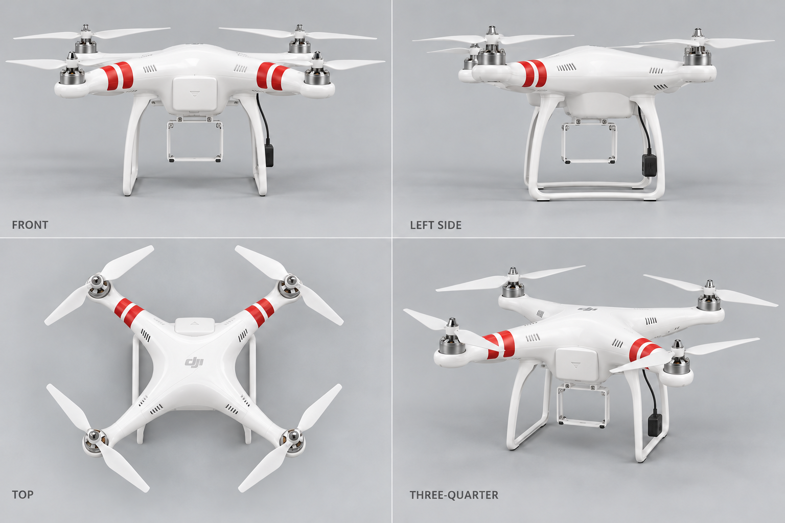
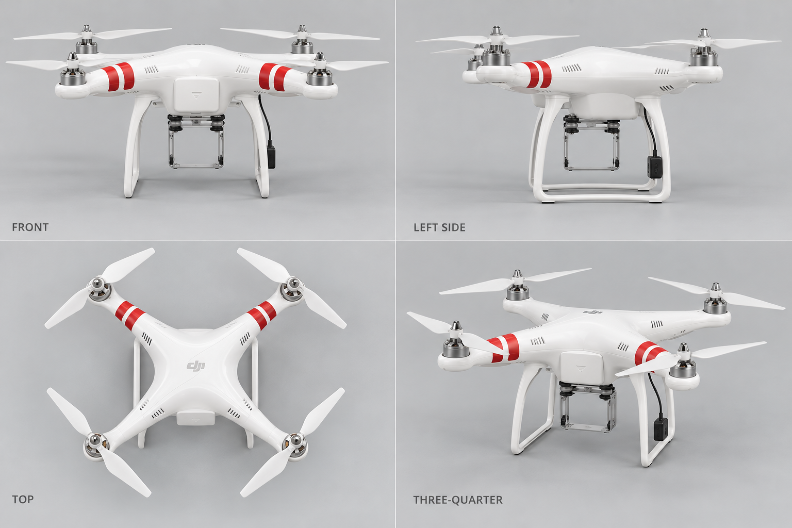

# 1.25 早期机型美术：DJI Phantom 首代审核稿

日期：2026-10-09（America/Los_Angeles）

产品线：DJI 目录 / 早期 3D 美术

机型 ID：`dji-phantom-1`（与冻结目录一致）

当前稿件：`draft-02`
外观确认：`pending_user`，尚未获得用户逐机型确认。

## 稿件用途与边界

本轮交付是内置 image_gen 生成的摄影级 3D 风格**概念位图**，不是可运行网格、不是 UV / PBR 材质套件，也不是 DJI 官方产品照片。仅可进入外观审核画廊。未经用户对机型、稿件版本及 SHA-256 的单独确认，不得加入正式选机飞行或最终 3D 资产。

目标限定为原版首代 DJI Phantom（后称 Phantom 1），不混入 Phantom FC40、Phantom 2、Vision 或之后的 Phantom。图稿没有集成相机，白色固定臂、四轴四桨、前臂双红带、两侧起落脚与空 GoPro 安装框用于核对第一代的识别特征。

## 当前审核稿



- 尺寸：1536 × 1024。
- 图内视图标签：FRONT、LEFT SIDE、TOP、THREE-QUARTER。
- SHA-256：`0bd916ac7627cfb0d07957199ced134358e593ddeaaaa6334e6df4cd0b18f698`。
- 紧凑审核清单：[review-drafts.json](../assets/v125-art/legacy/review-drafts.json)。

## 官方依据

以下来源于 2026-10-09 核查；在线下载中心含其他 Phantom 资料，不能把同一下载页的其他机型文件当成首代外观依据。

| 官方来源 | 本轮核对内容 |
| --- | --- |
| [DJI Phantom 1 下载中心](https://www.dji.com/downloads/products/phantom) | Phantom 1 产品身份、首代手册入口；不是发布日期的单一证明。 |
| [DJI Phantom Quick Start Manual V1.7（2013-09-25）](https://dl.djicdn.com/downloads/phantom/en/PHANTOM_Quick_Start_Manual_v1.7_en.pdf) | 第 6 页的白壳固定臂、双红带、起落架和空相机安装框；第 7 页零件图；第 9 页原装 8-inch 双叶桨；第 10 页脚部指南针与线缆；第 11 页前部电池舱门。 |
| [DJI Phantom Quick Start Manual V1.5（2013-04-09）](https://download.dji-innovations.com/downloads/phantom/en/PHANTOM_Quick_Start_Manual_v1.5_en.pdf) | 较早首代资料的交叉参考：机型采用独立 GoPro 支架，资料不能支持加入 Vision 集成相机。 |

V1.7 官方 PDF 的第 6、7、11 页在本地渲染后实际观看，再用作内置工具的支持性参考。未将完整官方 PDF 或手册页面提交仓库。

## 人工观察与未解决项

| 项目 | 本轮观察 |
| --- | --- |
| 白色非折叠 X 型机身 / 四电机四桨 | 能辨认出首代 Phantom 的整体轮廓；各视图没有混入 Mavic 折叠臂。 |
| 两个前臂各有两条红带 | 两版均保持；没有改成 Phantom 3 的金色 / 银色条带。 |
| 集成相机 / Vision 球形相机 | 两版均未出现。仅有空安装框。 |
| draft-01 的 TOP 电池舱门方向 | 与正视图和官方第 11 页冲突；draft-02 把门移动到了红带前臂所在的前侧。 |
| draft-01 的黑色减振球与双层安装板 | 疑似混入非原版支架；draft-02 已移除明显的黑色减振球，并改成简易固定空框。 |
| TOP 电池舱门在壳体上的具体高度和外露量 | draft-02 有把舱门显示成壳体上表面小凸盖的倾向，原机为机身前侧开口；仍须细化。 |
| GoPro 固定支架拓扑、螺丝 / 卡扣 | draft-02 是近似表现，尚未证明与第 6 页原装支架逐零件一致。 |
| 正 / 左侧 / 顶视严格正交 | 图稿有轻微透视，左侧桨和两个脚有遮挡；不能当成尺寸精确的建模蓝图。 |
| 指南针的左右定义、圆形尾部 LED、底部通风和线缆走向 | 首轮未逐细节证明准确；需要补充后视 / 底视和更清晰的官方实物参考。 |
| 真实比例 | 未由可测量原机、CAD 或摄影测量验证；不宣称 1:1。 |

以上为美术自查，不代替独立 QA 或用户确认。当前待确认稿可供用户指出轮廓和硬件错误；有未解决项并不意味着已获准进入正式资产。

## 历史稿

`draft-01` 保留用于追溯，当前审核入口选 `draft-02`。



- 文件：`assets/v125-art/legacy/phantom-first-generation-draft-01.png`。
- 尺寸：1536 × 1024。
- SHA-256：`447e34b5d4676bfe3fd24c3eba0bc279ddc675a2f46a5dd90257368055765b08`。
- 历史稿未获用户确认；修订也没有继承任何确认。

## 最终提示词与执行方式

方式：内置 `image_gen`，两次调用；没有使用 CLI / API fallback。

### draft-01 生成提示词

```text
Use case: product-mockup
Asset type: AeroSim 1.25 individual aircraft appearance review bitmap, draft-01; a reference turnaround sheet, not an operational mesh.
Primary request: A photorealistic 3D-style four-view studio turnaround of the DJI Phantom original first generation (2013), the aircraft originally named Phantom, not Phantom FC40, Phantom 2, Phantom Vision, Phantom 3 or Phantom 4.
Input images: Image 1 and Image 2 are supporting official DJI Phantom V1.7 manual diagrams, viewed before this request. Use ONLY the illustrated aircraft geometry as an appearance reference; do not copy the manual pages, paragraphs or diagrams into the output.
Scene/backdrop: clean light neutral gray studio sheet, simple 2x2 grid with generous whitespace and subtle floor shadows.
Subject: identical single aircraft in all four panels. Original white rounded X-shaped molded-plastic central body and four fixed non-folding arms, four small exposed metal motors at arm tips, four white original 8-inch two-bladed propellers with center nuts. Each of the two FRONT arms has TWO thin red bands. Rear arms have no red bands. Two narrow white U-shaped landing skids, one on each side, running front-to-back, black compass module attached low to the right landing skid with a fine cable. Battery compartment door at the front; small round status indicator on rear underside. An empty simple original GoPro camera mounting frame under the center, NO camera installed. No integrated camera, no spherical camera, no silver gimbal, no modern vision sensors, no obstacle avoidance lenses, no intelligent-flight-battery button.
Style/medium: premium but accurate photorealistic PBR-like studio product rendering; lightly satin white plastic, red vinyl arm bands, brushed motor metal; realistic thin blades and small screws.
Composition/framing: TOP LEFT true FRONT view from nose, TOP RIGHT true LEFT SIDE view, BOTTOM LEFT orthographic TOP view (nose at top), BOTTOM RIGHT elevated FRONT THREE-QUARTER view. All whole aircraft and propeller tips fully visible. Keep consistent scale and the EXACT SAME body, motor locations, skids and red band positions across all four views. Perspective-free front/side/top panels; natural perspective only in three-quarter panel.
Lighting/mood: broad soft studio illumination, neutral color, controlled shading revealing shape.
Text (verbatim): small dark-gray sans-serif labels only: "FRONT", "LEFT SIDE", "TOP", "THREE-QUARTER". No headline or other labels, no watermark.
Constraints: this is the ORIGINAL DJI Phantom first-generation standard configuration, camera-free with empty original mounting frame. Exactly 4 motors and 4 two-bladed propellers on each aircraft; front pair bands wrap each front arm twice; one drone per panel, complete silhouettes, geometry and marking consistency, no accessories outside aircraft.
Avoid: foldable Mavic body; Phantom Vision spherical camera; Phantom 2 battery slider; modern gimbal camera; Phantom 4 smooth elongated legs; propeller guards; extra arms; tiny impossible blades; aesthetic redesign.
```

### draft-02 编辑提示词

```text
Use case: precise-object-edit
Asset type: AeroSim 1.25 DJI Phantom original first-generation appearance review bitmap, draft-02.
Input images: Image 1 is the EDIT TARGET (generated draft-01 turnaround). Image 2 is SUPPORTING REFERENCE ONLY (official DJI Phantom V1.7 manual, original camera-frame illustration). Image 3 is SUPPORTING REFERENCE ONLY (official DJI Phantom V1.7 manual showing the FRONT battery hatch between red-banded arms). Do not reproduce source manual text or layout.
Primary request: Correct ONLY the first-generation hardware details and view consistency of Image 1. Preserve its excellent lighting, materials, sheet composition, labels, white fixed-arm aircraft, two red bands on each FRONT arm, four white two-bladed propellers, landing skids and black compass.
Correction 1: In the bottom-left TOP panel, the red-banded pair at the top of the panel is the FRONT. The battery-compartment hatch belongs between those TOP FRONT red-banded arms. Move the small front battery-door shape from the bottom/rear edge to the top/front edge so it matches the front and three-quarter panels; rear edge should not show a battery door. Use reference Image 3 for the front hatch location. Do not move red bands.
Correction 2: The empty camera mounting frame under the body is the original simple fixed GoPro frame illustrated in Image 2, with NO GoPro camera. Remove the added black vibration isolator balls and modern two-plate gimbal assembly above that frame. Keep a simple rigid original fixed mounting attachment and an empty white rectangular open camera holder, with no lens, no camera and no gimbal. Apply the same identical empty fixed frame in FRONT, LEFT SIDE and THREE-QUARTER views.
Constraints: change only those hardware details, everything else unchanged. Preserve exact English labels "FRONT", "LEFT SIDE", "TOP", "THREE-QUARTER", all propeller tips, overall proportions and neutral gray background. This is original DJI Phantom, not FC40 or Vision. No new labels, no other accessories, no cropping.
```

## 确认记录

本轮不存在用户确认记录。根负责人、美术、程序员和自动化不得改变 `pending_user` 为通过。用户决定必须绑定机型 ID、稿件版本与上列散列；后续改变外观需要重新确认。

根负责人负责将此审核稿以仓库相对路径同步到主产品文档，再进行范围核查、Git 提交与推送；本美术任务没有提交或推送共享半成品。
