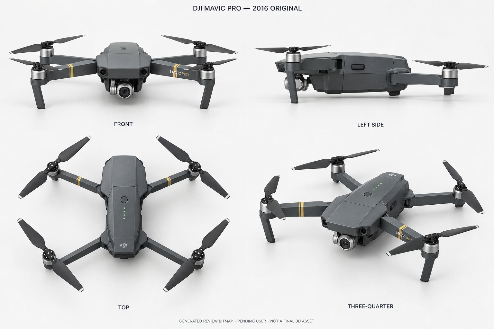

# AeroSim 1.25 首代折叠机型美术审核稿

## DJI Mavic Pro (2016 原版深灰) · draft-01

外观状态：`pending_user`。精确机型 ID：`dji-mavic-pro`。本稿只对应 2016 年原版深灰机身，不对应独立的 `dji-mavic-pro-platinum`、`dji-mavic-pro-alpine-white` 或警用版本，也不从它们继承用户确认。



- 稿件版本：`draft-01`
- 图像：`assets/v125-art/mavic/mavic-pro-draft-01.png`
- SHA-256：`70570d7d9b15aabf4ef7f1c7d0b65c0da8fd3cb1eacbc003bc1351a686cddeb4`
- 实际文件：1536 × 1024、8-bit RGB PNG；内置工具单次生成后原字节复制到仓库，`cmp` 比较源文件与副本通过。
- 稿件记录：[review-drafts.json](../assets/v125-art/mavic/review-drafts.json)
- 完整原始提示词副本：[mavic-pro-draft-01.prompt.txt](../assets/v125-art/mavic/mavic-pro-draft-01.prompt.txt)
- 生成方式：内置 `image_gen`，仅一次新图生成；`transparent_background=false`，未传入图像编辑目标，未使用 CLI/API fallback。
- 类型：`generated_review_bitmap`。这是摄影级 3D 式审核位图，不是 DJI 官方产品照片、已运行的三维模型、测量图或最终资产。没有产生网格、UV、LOD、碰撞器或最终 PBR 材质。

## 官方依据与身份边界

检索/实际观察日期：2026-10-09（America/Los_Angeles）。先读取当前目录的母型身份、2016 年份、独立特别版和 `pending_user` 门禁，再检索 DJI 官方主源。目录既有母型来源中使用 Alpine White 公告做身份依据；本次外观提示没有把白色特别版作为深灰原版的配色依据，未修改共享目录。

1. [DJI 2016 年中文发布稿](https://u.dji.com/cn/articles/36)：实际读取正文；明确原版折叠四臂、前视/下视各一对视觉摄像头和小型三轴 4K 云台。发布日期页面为 2016-09-27。
2. [原版产品信息页](https://www.dji.com/mavic/info)：读取原版规格；折叠包络为 83 × 83 × 198 mm、不含桨的对角尺寸为 335 mm，云台为三轴。尺寸只用于提示形体，生成图没有测量标定。
3. [Mavic Pro 官方支持页](https://www.dji.com/support/product/mavic)：读取机型、云台和电机不共平面的说明，并通过其两个官方云台图片链接实际查看原版相机朝向和前圆窗。
4. [官方下载中心](https://www.dji.com/downloads/products/mavic)：确认该机型手册入口；本轮使用的是下面的 2016.10 v1.0，而不是将较新兼容说明当作原版外观。
5. [2016.10 用户手册 v1.0](https://dl.djicdn.com/downloads/mavic/Mavic%20Pro%20User%20Manual%20V1.0.pdf)：在线预览因 17.2 MB 内容长度失败，转为下载到临时目录并按 PDF 检查流程渲染，实际打开第 6、7、8 页。第 6 页核对移除云台保护盖/固定夹和有标记/无标记快拆桨，第 7 页核对前后机臂展开构型，第 8 页核对正面、两侧与底部 Aircraft Diagram。官方页是结构参考，不等于本稿正交建模蓝图。
6. [2016 发布稿折叠产品照片](https://www4.djicdn.com/cms_uploads/ckeditor/pictures/724/content_mavic__7_.jpg)：实际在浏览器打开，核对深灰棱角壳、原版银灰小相机、黑桨、银色电机环、黄色双条与原版臂形。照片包含运输透明罩，本稿按手册采用无罩飞行构型。
7. [2016 发布稿展开飞行照片](https://www4.djicdn.com/cms_uploads/ckeditor/pictures/725/content_4.jpg)：实际在浏览器打开；核对展开臂和前支脚大轮廓，照片为低光且旋桨有运动模糊，不能据此证明静态桨细节。
8. [官方云台照片 203](https://www1.djicdn.com/uploads/share_image/image/203/f37f548d7e85eb6d9aeb75460c808072.png) 和 [官方云台照片 204](https://www1.djicdn.com/uploads/share_image/image/204/45c6a77550dd736bdbbd45100e9aafbd.jpg)：实际查看两张 230 × 130 图。用于核对圆窗与原版小型单摄云台，而非 Mavic 2 方形相机或后代多摄模组。

官方照片只在浏览器观察，没有复制到仓库作为原创资产。本次生成工具收到下面的文字提示，没有把参考照片重新包装为生成物。临时手册/PDF 页不属于提交资产。

## 实际看图检查与未解决差异

生成结果已显示，复制后的仓库 PNG 又通过 `view_image` 实际打开检查；哈希、PNG 格式和尺寸已核对。四个标签 FRONT / LEFT SIDE / TOP / THREE-QUARTER 清晰可见，整体是深灰展开四旋翼、前双圆窗、单摄云台、黄色前臂双条；没有明显混入 Platinum 银壳、Alpine White 白壳、Mini 浅灰轮廓或后代双/三摄模块。

这不代表已经一致复刻，以下问题保留：

- FRONT 带轻微俯角，不是提示要求的水平正交正面；后排电机在图面上较高，不能与 LEFT SIDE 直接判定真实前后电机高差。TOP 也显示了部分电机侧面，四图不是经标定的统一正交投影。
- 四图桨叶相位与遮挡没有证明一致，快拆桨的有环/无环标记没有充分分清。生成桨尖出现浅色条带；其位置/宽度未按官方原版 8330 近照验证，不能借黑桨大轮廓宣称已完成准确桨型。
- 原版相机本体、云台横轴支架和鼻下开口在稿中偏粗、偏简化；与官方云台小图仍需高清逐面核对。没有完成相机、双圆窗与机身宽度的测量比例验证。
- 前臂横截面与后臂铰链被块状化，黄色双条在视图间位置/宽度仍需核对；MAVIC PRO 字样的侧向位置与近景字体也未验收。
- LEFT SIDE 的侧盖/接口简化为少量矩形细节，Micro USB、相机 Micro SD 卡槽、控制模式开关和链接按钮的左右侧归属没有全部落实，不能把该侧面当作准确拓扑依据。
- 底部双下视、超声波、散热板及后部状态灯没有完整展示；尚无底部审核稿。表面粗糙度、传感玻璃和银色金属只是视觉提示，不是材质测量值。
- 图面存在生成漂移且无真实网格，不能用本图直接制造可运行 3D 模型，也没有转台或实机对照检验。用户人工确认尚未发生。

因此本稿可进入外观审核画廊，但不能进入正式可飞选机或最终 3D 资产。用户确认必须绑定 `dji-mavic-pro`、`draft-01` 与上述 SHA-256；根负责人、美术、程序员及自动化不能代用户确认。已确认外观之后若修改图/网格，仍须重新确认。

## 完整实际生成提示词

以下为内置工具收到的全文，无事后改写；单次生成，未进行修图或二次生成。

```text
Use case: product-mockup
Asset type: AeroSim 1.25 per-aircraft exterior review bitmap, not a final 3D asset or an official product photograph.
Primary request: Create one photorealistic neutral-studio four-view turnaround sheet of the original 2016 DJI Mavic Pro, exact aircraft identity dji-mavic-pro, standard dark-gray version. The four views must depict the very same aircraft with identical geometry, materials, scale, unfolded arm configuration and unfolded stationary propeller arrangement.
Scene/backdrop: Clean off-white seamless studio backdrop, subtle soft contact shadows, no scenery, no props, no controller, no packaging.
Subject: The original first-generation Mavic Pro: compact elongated angular charcoal-gray body with faceted nose, two circular forward vision windows separated horizontally on the nose, and the original very small single-lens silver-gray cylindrical camera under the nose on its compact three-axis gimbal. The camera is unobstructed, centered and facing straight forward; remove both the transparent protective dome and the transport clamp. Slim original folding arms, four cylindrical motors with metallic silver motor bands, two narrow yellow bands near the outer ends of the front arms, restrained MAVIC PRO lettering. Front arms extend forward and outward; rear arms extend backward and outward. Two front-motor landing struts extend down with a slight splay; rear motors are lower than the front motors, following the original aircraft. Plain black original two-leaf folding quick-release propellers, every blade fully unfolded and stationary. Show the small top battery power button and four green battery indicator points in their original longitudinal arrangement. Body proportions should be guided by the official 83 x 83 x 198 mm folded envelope and 335 mm motor-diagonal dimension, without printing a measurement drawing.
Style/medium: Photorealistic high-fidelity 3D-style product rendering for human visual review, matte graphite polymer shell, subtle fine plastic surface grain, dark sensor glass, realistic silver motor and gimbal surfaces, original restrained yellow arm accents. Clean soft neutral studio light; no dramatic grading, glow, motion blur or exaggerated shine.
Composition/framing: One landscape 3:2 sheet, four evenly spaced panels arranged 2 x 2. Upper left FRONT: level straight-on front elevation, all parts clearly legible. Upper right LEFT SIDE: true left profile, nose pointing to the left of the sheet; no right-side port arrangement substituted. Lower left TOP: directly overhead, nose pointing toward the top of this panel. Lower right THREE-QUARTER: elevated front-left three-quarter view. Keep whole aircraft and every propeller tip visible in all panels with generous margins. Front, left side and top should be close to orthographic, with no wide-angle distortion. Maintain the same object scale and the same exact deployed physical configuration, propeller phase and arm topology across all four views.
Text (verbatim): Panel labels "FRONT", "LEFT SIDE", "TOP", "THREE-QUARTER" in small clean dark sans-serif text below each corresponding panel. Small header "DJI MAVIC PRO — 2016 ORIGINAL". Small footer "GENERATED REVIEW BITMAP · PENDING USER · NOT A FINAL 3D ASSET". No other graphic labels, measurement arrows or invented specification claims.
Constraints: Exactly four arms, four motors and four two-leaf propellers on each depiction; no missing or duplicate rotors. Preserve the original two round front vision windows and tiny single-camera three-axis gimbal. All four views are the same fully unfolded aircraft, not different states, not different models. Keep markings secondary to accurate physical forms.
Avoid: Mavic Pro Platinum silver shell or swept low-noise propellers; Alpine White; Mavic 2 box camera, white arm stripes, additional rear or lateral obstacle sensors; Mavic 3 multi-camera module; Mini rounded pale-gray silhouette or orange propeller tips; extra landing skids; propeller cages; industrial payloads; display stand; cutaway; exploded view; blueprint; official-photo claims; approval claims; final production asset claims.
```

## 交付范围

本轮只新增 `assets/v125-art/mavic/` 内的 PNG、提示词、审核记录和本文档；没有改 catalog、产品文档、Unity、UI 或其他美术目录，未执行 Git 写操作。根负责人负责整合审核画廊/产品文档和统一验证、提交、推送；本美术成员未自行提交或推送。
