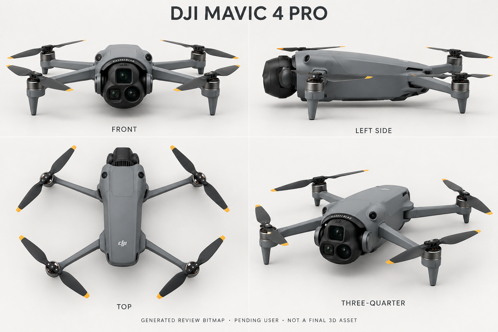

# AeroSim 1.25 · DJI Mavic 4 Pro 美术交接

观察日期：2026-10-10（America/Los_Angeles）。本轮机型/3D 美术成员只写本文档，不修改旧 PNG、旧提示词、旧 manifest、共享 catalog、产品文档或 Unity，不执行 Git 写操作。根负责人统一整合和交付。

## 身份与确认边界

当前“pro4”展示按根负责人明确的 **DJI Mavic 4 Pro** 理解，精确 ID 为 `dji-mavic-4-pro`，不是把 2016 年 `dji-mavic-pro` 重命名。只表示当前展示机型方向；新稿仍必须为 `pending_user`，不构成用户对任何稿件外观的确认。

| 条目 | 本轮只读核对结果 | 禁止混用 |
| --- | --- | --- |
| `dji-mavic-pro` | catalog 为 2016 首代折叠机；旧 `assets/v125-art/mavic/review-drafts.json` 当前为 `draft-02`、SHA `ace4e4d0edad8555ac726a8b2c674c4a7513201cc8c01bcac8927fd12c462931`、`pending_user` | 不改 ID、不覆盖历史，不将银灰单摄与黄色前臂双条沿用到 Mavic 4 Pro |
| `dji-mavic-4-pro` | catalog 为 2025 三摄旗舰，`pending_user`、`not_created`、`not_integrated`、`productionAssetAllowed=false` | 不继承首代稿件或其他机型确认 |
| `dji-mavic-4-pro-512gb` | 目录独立硬件条目；官方规格区分 64GB 母型与 512GB Creator Combo 机体 | 本轮普通母型新稿不自动成为 512GB 的用户确认稿 |

已完整读取仓库 `AGENTS.md`、旧 [Mavic 美术记录](V125_ART_MAVIC.md)、旧 manifest 与提示词，且通过 `view_image` 实际打开旧 `draft-01` 和 `draft-02`。两张旧稿均显示小型单镜头银灰云台、棱角深灰壳及黄色前臂双条；这只核对历史身份，不改变其未通过项。

## 官方主源与实际观察

本次先用网页检索/读取主源；无地区产品地址、无地区规格地址及目录内西语发布稿在网页读取工具中返回 404，未把失败写成成功。随后通过正常 CUA 浏览器打开以下官方页面和其 DOM 暴露的产品图片，实际取得截图观察；没有下载、重制或提交 DJI 图片，也没有通过 shell 浏览器、网页截图脚本或未经声明的第三方图源观察。

| 官方来源 | 本次实际读取/观察范围 |
| --- | --- |
| [DJI Singapore 产品页](https://www.dji.com/sg/mavic-4-pro?from=store-product-page) | 实际浏览，确认正式产品身份；从页面可见 `DJI Mavic 4 Pro` 图像节点取到下方整机对照图 URL |
| [DJI Singapore 官方商城](https://store.dji.com/sg/product/dji-mavic-4-pro?from=site-nav&set_region=SG&site=brandsite&vid=189291) | 实际浏览标题、三摄/Infinity Gimbal说明、图片 DOM；选择项保持普通 DJI RC 2 版本，没有购买或改账户 |
| [DJI 官方规格](https://www.dji.com/sg/mavic-4-pro/specs) | 通过产品页 Specs 链接实际读取：三轴机械云台、三镜头焦距、展开尺寸、存储版本与传感系统类别；不是测量建模蓝图 |
| [DJI Infinity Gimbal 说明](https://repair.dji.com/help/content?customId=01700012427&lang=en&paperDocType=ARTICLE&re=US&spaceId=17) | 网页工具实际读取“new sphere gimbal architecture”、旋转与仰拍说明；本轮展示建议采用中性正向，不把可旋转能力当作随意镜像镜头的依据 |

以下均为官方页面已有图源，可直接交给根负责人在浏览器打开并截图观察；“实际观察”是本成员本轮已做，不代表根负责人已看：

1. [三摄正面详图 · 2400×1130](https://se-cdn.djiits.com/stormsend/uploads/099c259d7da1670b291a22b0364395e4.jpg?h=1130&thumb=BAgGA4AIuWaIhjmH%2B5imj3k%3D&w=2400)：已实际观察，最适合核对镜头排布。
2. [展开整机官方对照图 · 870×870](https://www-cdn.djiits.com/cms/uploads/979ab68fd602bd3440fc4fb12f3ea38e.png)：已实际观察，最适合核对整体臂、桨、电机与球形云台比例。
3. [低角度展开飞行图 · 1280×1280](https://se-cdn.djiits.com/tpc/uploads/carousel/image/8fe1c5ccc0960e9a209cb33025d0c9a8@ultra.jpg?format=webp)：已实际观察，可见前支脚、鼻部球形云台及部分底部，但旋桨有运动模糊，不作为静态桨叶相位依据。
4. [三摄斜向近景 · 1280×1280](https://se-cdn.djiits.com/tpc/uploads/carousel/image/7e4091819b6bed49b07a08782117e3cc@ultra.jpg?format=webp)：已实际观察，核对左右轴座与前面板厚度；不是整体正交图。
5. [折叠机与 RC 2 商城首图](https://se-cdn.djiits.com/tpc/uploads/carousel/image/2a54d78df1b59dec6add210a8e75ac7d@ultra.jpg?format=webp)：在商城截图中实际观察，辅助核对上壳、折叠构型与配色；不要将配件加进逐机型外观稿。

## 可进入提示词的外形锚点

### 三摄与云台：最高优先级

以下左右均以**中性正向云台、面对飞机的观者**为准，不能在 FRONT 或 THREE-QUARTER 中悄悄镜像。旋转状态不同会改变图面方位，因此审核稿应固定中性姿态。

| 正面位置 | 官方详图实见形状 | 镜头身份 |
| --- | --- | --- |
| 上方中央 | 最大开口，削角方形/八角外框；不是三颗均匀圆孔之一 | 28mm Hasselblad 主摄 |
| 下方观者左 | 较小开口，削角圆角方形外框、内有圆形光学镜头 | 70mm 中长焦 |
| 下方观者右 | 外镜筒更显圆形、较大，凸出的圆形边缘 | 168mm 长焦 |

三者位于同一黑色球形/圆拱式 Infinity Gimbal 前面板内；上沿为弧形 `HASSELBLAD` 标识，左右有圆弧轴座/转动侧件，整体从机鼻前端突出。不能画成首代银色小圆筒、Mavic 2 方盒、Mavic 3 Pro 的另一种三摄模组、三颗等大同形镜头，或三颗横排镜头。[官方近景](https://se-cdn.djiits.com/stormsend/uploads/099c259d7da1670b291a22b0364395e4.jpg?h=1130&thumb=BAgGA4AIuWaIhjmH%2B5imj3k%3D&w=2400)

### 机体、臂、桨与传感器

- 官方展开图是中灰色、较圆润但有清楚壳线的长机身，黑色前云台；四条细长折叠臂、四个电机。前电机下有收尖短支脚，不能加传统成对长橇。后臂从较后位置向外/后展开；不要搬用首代粗棱角臂和黄色双条。
- 静态整机图实见每电机两片黑色折叠桨叶，桨尖为黄橙/琥珀色小段，不是白色大片或纯黑无尖端标记。展开图中无护桨罩、控制器或载荷。精确桨根锁扣、正反桨标记、桨尖色值仍未近照标定。
- 机身顶面可见两处前部小暗色圆窗及后方标识；斜向相机近景中前电机区域可见暗色矩形/圆角窗。它们不能与主摄三镜头混为一组。官方规格明确全向双目视觉、前向 LiDAR 与底部红外；本轮没有读取用户手册 Aircraft Diagram，也没有查看完整背面/底面高分辨率图，因此**不声明每个窗口的器件身份、完整数量和安装坐标已经全部验证**。提示应复制可见位置，不凭首代鼻角双圆窗模板添设传感器。
- 官方展开不含桨尺寸为 328.7×390.5×135.2 mm；这是比例检查的参考，不是生成图已通过毫米级标定。光照会影响灰壳与桨尖色彩，不能将产品网页视觉当作最终 PBR 测量。

整机观察依据：[官方展开对照图](https://www-cdn.djiits.com/cms/uploads/979ab68fd602bd3440fc4fb12f3ea38e.png)、[飞行低角度图](https://se-cdn.djiits.com/tpc/uploads/carousel/image/8fe1c5ccc0960e9a209cb33025d0c9a8@ultra.jpg?format=webp)。传感类别与尺寸依据：[官方规格](https://www.dji.com/sg/mavic-4-pro/specs)。

## 供根负责人生成/审稿的精确提示建议

此段是**建议**，不是已经调用生成工具的实际提示词；生成者应保存工具真正收到的完整提示词和结果散列。首代旧 PNG 不应作为编辑目标来“变型号”；建议建立新机型独立文件与清单。

```text
Create a new photorealistic neutral-studio exterior review bitmap of the standard DJI Mavic 4 Pro, aircraft identity dji-mavic-4-pro, not the original 2016 Mavic Pro and not an approved production asset. Use one consistent fully unfolded aircraft, exactly four arms, four motors and four unfolded stationary two-leaf propellers. Medium-gray contemporary rounded/faceted shell, slender folding arms, tapered short landing struts beneath the front motors, black propellers with restrained amber/yellow-orange tip segments. No yellow twin stripes from the original Mavic Pro, no silver first-generation single-camera barrel, no landing skids or extra rotors.

The defining feature is the black spherical Infinity Gimbal projecting from the front of the nose, with visible circular side pivots and one three-camera front face. Lock the camera to its neutral forward-facing, non-rotated attitude. Facing the aircraft, the largest 28mm Hasselblad opening is centered at the TOP in a clipped-square/octagonal surround; the smaller 70mm opening is at the viewer's LOWER LEFT inside a clipped rounded-square surround; the 168mm opening is at the viewer's LOWER RIGHT with a visibly round larger outer lens barrel. Preserve this exact asymmetry and handedness wherever the front face is visible. The curved upper rim bears small HASSELBLAD lettering. Do not render three equal circular holes, a horizontal three-lens row, a Mavic 3 Pro camera module or a silver single camera.

Use the observed official whole-aircraft silhouette and visible sensor-window placement. Distinguish body sensing windows from the three imaging lenses. Do not invent unseen ports, backside sensor layouts or underside details; unverified details must remain listed as review limitations, not claimed as measured engineering geometry. Keep the gimbal side clearances physically legible and keep the camera face from being hidden by an invented transport cover.

If producing a four-view review sheet: FRONT is a level front elevation, LEFT SIDE a true left profile, TOP directly overhead, and THREE-QUARTER an elevated front-left view. Maintain the same object scale, deployed arm topology, neutral gimbal pose and propeller phase in all views; show all tips with margins. Neutral off-white studio background, soft shadows, no scenery, controller, package or payload. Label the exact model DJI MAVIC 4 PRO and footer GENERATED REVIEW BITMAP · PENDING USER · NOT A FINAL 3D ASSET. A visually convincing sheet is not calibrated CAD, a runnable mesh, UV/LOD/collider, PBR final material or user approval.
```

## 本轮状态与后续独立检查

本成员未生成图像、未下载 DJI 官方图像、未修改历史稿或批准字段。等待根负责人交付新稿路径后，将实际 `view_image` 检查本地结果，再在本文档追加版本/散列、观察到的改善与残留差异；不能把提示词要求当作实际图像已实现。新稿只可用于 `pending_user` 审核画廊。正式选机飞行、最终 3D 资产及 512GB 确认均仍受逐机型用户门禁约束。

## 第二阶段：Mavic 4 Pro · draft-01 独立实际看图

2026-10-10 根负责人交付新稿后，本美术成员通过 `view_image(detail="original")` 实际打开仓库 PNG，并读取其完整实际提示词。下文为看图结果，不是从提示词推定已实现。第一阶段参考说明保留为研究历史，本节是此稿的独立检查记录。



- 精确机型：`dji-mavic-4-pro`；稿件版本：`draft-01`；外观状态：`pending_user`；类型：`generated_review_bitmap`。
- 图像：[mavic-4-pro-draft-01.png](../assets/v125-art/mavic/mavic-4-pro-draft-01.png)；本成员用 `file` 独立核对为 1536×1024、8-bit RGB、非交错 PNG，用 `shasum -a 256` 独立核对 SHA-256 为 `efdc1b0d6c5bf307968731e1c5f0afd9f40aa3e4e5a4eb3deb5382e090eaa9ab`。
- 完整实际提示词：[mavic-4-pro-draft-01.prompt.txt](../assets/v125-art/mavic/mavic-4-pro-draft-01.prompt.txt)。根负责人记录为内置 `image_gen` 一次全新生成，未编辑 2016 旧稿；官方照片只浏览，未下载或传入生成工具。上述“提示建议”不是该实际提示词的副本。
- 本成员另以 `cmp -s` 核对根负责人给出的默认产物 `/Users/bytedance/.codex/generated_images/01a1090a-e1d8-71f1-b263-00e6d13775f8/exec-a13efd60-ade8-49db-87b6-94c2ce86d0f3.png` 与仓库 PNG，退出码为 0，原字节相同。生成执行本身由根负责人完成，不冒称本成员调用。
- 本图是独立中性棚拍式概念审核位图，不是运行截图；1536×1024 是图像尺寸，不是电脑/iPad/iPhone运行验证视口，UI/HUD 比例不适用。没有产生真实网格、UV、LOD、碰撞器、最终 PBR 材质、可运行飞行机或实机外观证明。

### 实见成立的身份锚点

- 新图标题为 `DJI MAVIC 4 PRO`，四个标签 FRONT / LEFT SIDE / TOP / THREE-QUARTER 与未确认页脚实际可见。整体为中灰长机身、展开四旋翼、黑双叶桨与黄橙尖端，未见沿用首代黄色前臂双条或首代银色单摄。
- FRONT 与 THREE-QUARTER 实见黑色球形/圆拱三摄模组及两侧轴座。中性正面中上方为削角方形主摄、下左为较小近方框镜头、下右为较大圆形镜头；这两个可见前面板没有明显左右镜像。TOP 没有凭空再画三颗朝上的镜头。
- FRONT、TOP 与 THREE-QUARTER 的整体观察可分出四个电机和四组双叶桨，没有明显第五旋翼；LEFT SIDE 受重叠遮挡，不能仅凭侧面确认全部数量和机械连接。

这些锚点支持“新稿已与 2016 单摄稿分开”的身份检查，不等于尺寸、全部结构或全面视觉一致性通过。

### 尚未通过的外形与多视图残差

| 检查项 | 实际观察与边界 |
| --- | --- |
| 后电机额外支脚 | THREE-QUARTER 后方两电机与 LEFT SIDE 后电机下生成了明显收尖向下短脚；FRONT 后电机下也见短突起。第一阶段实际看的官方展开整机中，明确的长收尖支脚在前电机，后电机未见本稿这类明显收尖前腿复制。后电机壳底/支撑的真实结构尚未完整多角度核实，当前应列为后脚疑似添设/加长，而非宣布四支脚准确。TOP 自然不充分显露此问题，不能用 TOP 绕过检查。 |
| 主摄框形与比例 | 上方主摄有削角，但近方形、占前面板的比例偏小，削角幅度与官方大八角/削角方框仍有差异。官方正面详图中主摄外框显著占据上半面，本稿上框更紧凑且与右下镜筒的视觉尺寸接近；仅“上大、下二”排布成立，框形/尺度没有闭合或测量通过。 |
| 云台侧轴/机械结构 | 两侧轴座被生成成亮银色厚环/圆盘，官方近景的侧件观感更暗、更融合在黑色球形机构中。连接间隙、真实轴拓扑与厚度未对齐；球形大轮廓不能替代机械准确性。 |
| 传感器拓扑 | FRONT 鼻肩两圆窗较大、凸起并明显前向；THREE-QUARTER 圆窗也前向圆筒化。官方整机里可见的顶前窗较小且融入上表面，本稿不能宣称完整对应。没有完整底/背面核对，仍无法确认每个视觉/LiDAR/红外窗口的身份、数量与坐标；不从两颗前窗推断全向系统已经复刻。 |
| 臂/机壳/接口 | 臂连接和壳线呈泛化块状结构；LEFT SIDE 有额外小圆角矩形细节、后侧开口和底部条形暗槽，TOP 前云台后方有条列式黑色缝隙。它们未在本轮官方多角度照片中逐项证实，不能当作精确接口/散热拓扑。两条前臂粗细、铰链与真实比例仍需核对。 |
| 投影与跨视图一致性 | FRONT 可见较多顶壳且后电机在画面更高，仍带俯视，不是经标定水平正交正面。四格是独立生成投影，没有共同网格保证；侧面只证实鼻朝左，不能以文字 LEFT SIDE 证明接口左右归属准确。相机姿态、桨叶相位、支脚长度及壳线的一致性未逐项闭合。 |
| 桨/材质 | 黑双叶、黄橙小尖端大方向成立，但桨型、尖端面积/色值、快拆根部/标记及四格相位未按高清近照量化。银色电机环、塑料粗糙度和光学玻璃只是生成观感，不能称最终 PBR。 |

主要对照仍为第一阶段已实际观察的[官方相机正面详图](https://se-cdn.djiits.com/stormsend/uploads/099c259d7da1670b291a22b0364395e4.jpg?h=1130&thumb=BAgGA4AIuWaIhjmH%2B5imj3k%3D&w=2400)、[官方整机展开图](https://www-cdn.djiits.com/cms/uploads/979ab68fd602bd3440fc4fb12f3ea38e.png)和[官方斜向相机近景](https://se-cdn.djiits.com/tpc/uploads/carousel/image/7e4091819b6bed49b07a08782117e3cc@ultra.jpg?format=webp)；本阶段没有新增手册、背面或底面验证，不将不存在的检查写成完成。

结论：此稿可作为当前 Mavic 4 Pro 的 `pending_user` 展示/审核候选，未通过全面外观复刻，不可直接加入正式选机飞行或最终 3D 资产。将来的用户确认必须绑定 `dji-mavic-4-pro`、`draft-01` 及上述完整 SHA；没有用户确认记录，本成员与根负责人都不能代批。2016 `dji-mavic-pro` 历史 PNG/提示词/清单仍保留，512GB 条目也不能从本稿自动继承确认。

本成员第二阶段仅追加本文档，没有修改新 PNG、提示词、manifest、catalog、PRD、Unity 或批准字段；没有 Git 写操作。此节交付后停止写入，供根负责人冻结、统一验证及提交推送。
