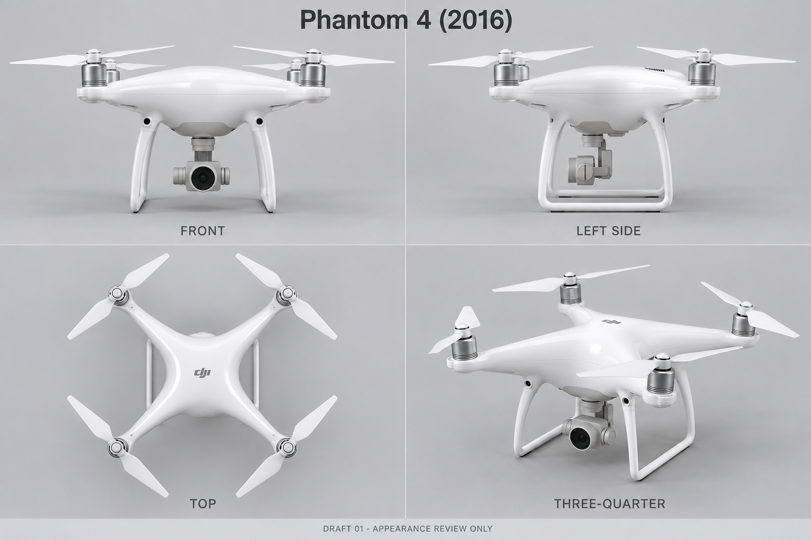

# Phantom 4 原版外观审核稿（1.25 美术线）

状态：`pending_user`。目标为 2016 年原版 Phantom 4，不是 Pro、Advanced、RTK 或 Pro V2.0。仅供逐机型外观审核；没有替用户确认，不接入 Unity 正式选机飞行或最终 3D 资产。

## 产物与实际执行

- 图稿：[phantom-4-draft-01.png](../assets/v125-art/phantom4/phantom-4-draft-01.png)，PNG，1536 × 1024。
- PNG SHA-256：`f5d855115819f4fbe1c1b4ec738cb0fbfc087338bd78d127f71f5d30df85d518`。
- 完整实际提示词：[prompt.txt](../assets/v125-art/phantom4/prompt.txt)，SHA-256：`ba184571e306deb958b591797fbf784d75ecfb1ce0281cd3444d9d09aa2a7f21`。
- 审核记录：[review-drafts.json](../assets/v125-art/phantom4/review-drafts.json)，唯一条目 `dji-phantom-4` / `draft-01` / `pending_user`。
- 使用内置 `image_gen` 的文字生成模式，一次调用成功；未传入未取得的参考图片，未使用 CLI/API 或付费回退，未追加修订。生成图原件保留在工具返回的默认目录，项目 PNG 是原字节复制，未重采样或图像编辑。
- 实际通过 `view_image` 检查项目 PNG 的全部四个面板。文字标签为 FRONT、LEFT SIDE、TOP、THREE-QUARTER；白色固定 X 型机臂、四个白色双叶桨、双起落架和单摄云台可辨。大轮廓可辨不等于外观准确、尺寸正确或人工验收通过。

## 官方依据与观察边界

查阅 [DJI 原版 Phantom 4 官方支持与规格页](https://www.dji.com/support/product/phantom-4)，读取原版规格与云台 FAQ；浏览器实际重定向到 [DJI Singapore 同型号官方支持页](https://www.dji.com/sg/support/product/phantom-4)，并实际查看页面顶部的前视产品照片。该照片用于核对白壳、固定机臂、前部视觉窗口、下置单摄及高起落架的大轮廓。

没有成功取得可供输入的官方图片文件；页面资源导出长时间未返回后被中断。官方手册在线读取也失败，因此没有宣称看过手册结构图，或看过官方左侧、俯视、三分之四照片。当前稿件不是官方照片复刻认证，更不是工程蓝图。

## 保留风险与后续审核

1. 左侧面云台支架和相机连接形态与正面、三分之四面板不一致；不可直接按四面板建模为一个精确网格。
2. 相机壳、镜头、云台支撑和电机壳偏粗，原版精确比例未通过高分辨率官方多视角校准。
3. 支脚弯曲、机壳高度、传感器窗口大小/位置、桨型和壳体接缝仍须逐项核对；左侧面有透视，不是校准正投影，俯视面也未清楚证明机头朝向。
4. 这是一张生成位图，没有 CAD、可运行网格、UV、PBR 贴图或飞行性能验证。用户必须针对 `dji-phantom-4` 的本稿版本和上列 SHA 单独确认；确认前不能变更为 approved。未来外观修改须重新确认。

本波仅新增上述美术线四个文件；未改旧图、目录批准记录、正式机型代码或 23 张原始概念图。冻结后交由根负责人整合 PRD/审核画廊和独立 QA；Git 提交、推送及远端核对由根负责人统一执行。
