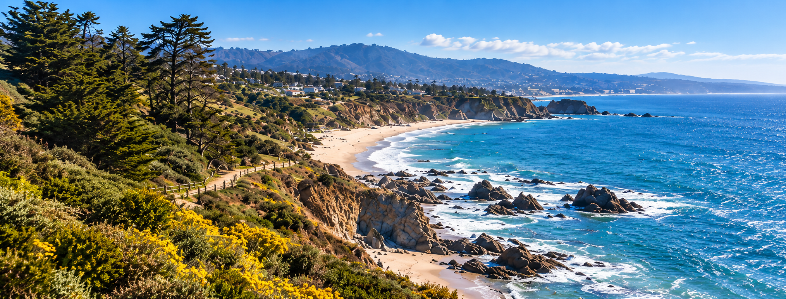

# AeroSim 1.0 海岸首页背景资产

状态：原创 AI 生成图像已交付，尚未代替完整产品视觉验收。日期：2026-10-08。



## 用途和边界

- 用于首页 Hero 的独立背景，保留标题、说明与 CTA 为可交互的原生界面元素；不是把整张概念界面作为图片显示。
- 晴天加州海湾、左前景柏树与灌木、中央弯曲海滩、远处沿海村落和丘陵、右侧蓝色海湾与白浪，依据 03 参考图的摄影构图制作。
- 左侧 40% 由自然深色树木及灌木占据，给真实文字叠层留空间；图稿本身没有绘制遮罩、文字、按钮、边框、Logo 或水印。
- 是原创摄影风格生成素材，不是美国某地点的经过验证的实拍、地图、Google Maps 数据，也不是可驾驶的实时 3D 场景。不能用于证明美国真实空域或禁飞区已接入。
- 原始 23 张产品概念图未修改。本资产的景物细节与概念图不会逐像素完全一致；页面的构图、文字、布局、缩放与交互仍须单独进行 QA。

## 来源和真实文件信息

| 字段 | 值 |
| --- | --- |
| 模式 | imagegen skill 默认 built-in `image_gen.imagegen`，非 CLI/API fallback |
| 分类 | `photorealistic-natural` |
| 输入参考 | `assets/aerosim-us-03-aerial-home.png`，仅参考 Hero 内的海岸摄影构图；不是编辑目标 |
| 参考 SHA-256 | `e24a8936787bd945a09a16c69e2fa0cd3814396c0070799c82f18c84cb7dd4dc` |
| 请求画幅 | 约 2.62:1，理想 2620 × 1000；请求值不冒充实际结果 |
| 工具实际输出 | **2029 × 775** PNG，约 2.618:1，3,424,017 字节 |
| 透明背景 | `false`，不需要透明背景 |
| 生成输出路径 | `/Users/bytedance/.codex/generated_images/01a11eea-51e7-7e62-875d-e2ee50d41192/exec-1e9e088b-249b-4f4f-9295-0a62bc769937.png` |
| 项目交付路径 | `assets/v1-art/coast/coast-hero-v1.png` |
| 交付 SHA-256 | `d658deb33b028b0772bb45f682dc3d123510b0dcdf0b4c916c8e8c26f7b174d7` |
| 后处理 | 原样复制工具生成的 PNG；未裁剪、未插值放大、未使用 Python 编辑 |

旧 `Resources/Art/CoastHero.png` 为 612 × 412；新图是重新生成的约 157 万像素原生输出，并非把旧图放大后宣称高清。在 1242 × 474 的目标 Hero 尺寸下可用缩小方式显示；更大实际显示尺寸仍需检查纹理进口设置和 DPI。

## 完整生成提示

```text
Use case: photorealistic-natural
Asset type: high-detail panoramic coastal background for the AeroSim desktop homepage hero; image asset only, not a UI screenshot.
Input images: Image 1 is ONLY a composition and photographic mood reference. Look at the coastline photograph inside its large upper hero card. The entire reference interface, text, buttons, panels, logo, and gradients are NOT part of the output.
Primary request: Create an ORIGINAL crisp natural aerial photograph of a sunny California Pacific coastal bay, closely matching that hero photograph's composition: left foreground rugged sandstone headland covered with dark green coastal cypress, scrub and small yellow wildflowers; coastline sweeping from the lower central foreground into a long crescent beach in the upper middle distance; small cream coastal homes in the middle distance and low mountainous hills across the horizon; broad vivid blue ocean and white surf predominantly on the right.
Composition/framing: Very wide PANORAMIC landscape, approximately 2.62:1 aspect ratio (ideally 2620 by 1000 pixels, use the highest native detail available). Low oblique drone viewpoint, not a vertical map. Left 40 percent is quieter, dark natural shrubs/trees/cliffs so live white heading and a button can be overlaid by the application, but DO NOT draw the heading, button or a dark translucent UI overlay. The beach curve and headland landmarks must remain visible in the center and right; ocean occupies the right half. A slim band of bright blue sky with soft small clouds at the top, natural distant haze. Keep foreground rock and plant detail sharply resolved so this remains believable across a 1242 by 474 hero viewport.
Lighting/mood: Clear late morning California sunlight, realistic exposure and natural coastal atmosphere, bright inviting training-day feeling. Not sunset, not storm, not hyper-saturated.
Materials/textures: Credible stratified rock, imperfect coastal shrubs, fine cypress branches, sandy crescent beach, subtly rippled blue water, foamy white waves breaking on dark shoreline rocks. Natural photographic detail, not stylized illustration or video-game terrain.
Text: none.
Constraints: ONLY the original full-bleed landscape photograph. Do not include drone hardware, person, aircraft, inset photo, frame, border, typography, labels, UI, buttons, nav bars, icons, logos, brand marks, watermark or readable signs. Do not reproduce the reference screenshot. Do not upscale the existing small CoastHero image.
```

## 美术检查与集成建议

已直接目视检查工具输出：海岸曲线、前景柏树/黄色野花、岩石白浪和右侧大片海水均清晰；无文字、控件、无人机或明显水印；画幅符合约 2.62:1 目标。

根负责人负责 Unity Resources 集成、PNG importer、主产品文档嵌入、真实应用截图与 GitHub 提交。建议保留原图完整画幅，不把左右海岸地标截掉；文字对比度不足时由真实 UI 绘制可调整的左侧渐变。这里不宣称构建完成、页面像素一致或已通过用户验收。
