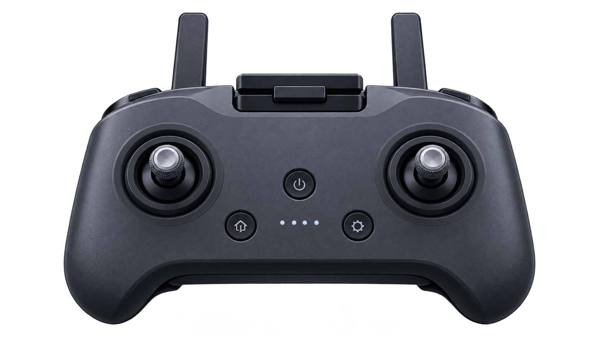

# AeroSim 1.0 设备美术交付

此处是新增 UI 位图素材，不是新的视觉验收基准。原始 23 张概念图未改动。素材不代表已完成 3D 遥控器模型、USB 设备支持或校准功能。

## 遥控器透明产品图



- 文件：`assets/v1-art/device/controller-cutout-v1.png`
- 实际尺寸：1671 × 941 px；PNG；RGBA。生成原图未经裁剪、颜色处理或去背景，alpha 原样保留。
- 用途：校准页的大幅遥控器视觉与首页 Controller 卡片。控制箭头、摇杆行程圆环、输入状态必须由运行时 UI 绘制，不能固化在位图上。
- 画面：深灰塑料外壳、黑色摇杆盘、金属滚花摇杆、两根天线；接近校准参考的正面偏俯视视角。无厂商品牌、文字、数字或屏幕数据。按钮上的通用图形不是品牌标志。
- 来源：内置 `image_gen`，2026-10-08；原创通用硬件产品图。不是 DJI 官方照片，也不声称获得 DJI 授权或商标使用权。不指定未经核实的第三方许可证；使用需遵守生成服务条款及项目正常权利审核。
- 生成原文件：`/Users/bytedance/.codex/generated_images/01a11ecd-12ce-7d30-9432-d45a087f19a4/exec-1ff6372f-c4ff-47bb-a389-bc12594998b6.png`
- 最终资产 SHA-256：`cb9fdc1a4640222a14d594975bbac361e56719ca0f0bcf0698a400473b6a67eb`

### 输入及来源记录

以下均为构图、材质或风格参考，不是编辑目标。没有修改任何原始参考。

| 参考 | SHA-256 |
| --- | --- |
| `assets/aerosim-us-02-controller-calibration.png` | `aff35fef57082ceff060d6623f5a813538bc4e813edd9302bfb6caffdc43e618` |
| `assets/aerosim-us-03-aerial-home.png` | `e24a8936787bd945a09a16c69e2fa0cd3814396c0070799c82f18c84cb7dd4dc` |
| `AeroSim/Assets/AeroSim/Resources/Art/Controller.png` | `6220af70230f0aeacd5ea30d9b0f58238a48416b4e63e6463d03124354868ef1` |

### 精确生成提示词

`transparent_background: true`，3 个参考路径按上表顺序传入；内置工具生成，不使用 CLI、API key 或外部下载。

```text
Use case: product-mockup
Asset type: AeroSim 1.0 controller-calibration and home-card transparent product cutout, NOT a UI screenshot or 3D model.
Input images: Image 1 (controller-calibration UI) is a visual style and viewing-angle REFERENCE ONLY; Image 2 (aerial home UI) is a proportions and material REFERENCE ONLY; Image 3 (existing controller crop) is a photographic realism REFERENCE ONLY. None is an edit target. Generate a new standalone original generic controller.
Primary request: One high-end generic dual-thumbstick drone radio controller, dark charcoal-gray body with black grips and black circular stick wells. Two upright slim antennas, a compact folded phone clamp at the upper center, two realistic metal-tipped knurled thumbsticks, subtle unmarked central buttons and four tiny neutral indicator dots. Rounded ergonomic shoulder contours and a bottom recessed grip bridge. No display screen.
Scene/backdrop: genuinely transparent alpha background, no room, floor or checkerboard baked into the pixels.
Style/medium: photorealistic premium studio product photography, finely resolved matte molded plastic grain, soft rubber grip texture, metal thumbstick highlights, realistic clean production seams.
Composition/framing: centered whole product, symmetrical front/top three-quarter view looking slightly downward, with frontal facing button panel; camera remains close to the original calibration reference's perspective. Both antennas and all grips fully visible. Product occupies approximately 80 percent of canvas width, generous transparent margins all around. Wide landscape canvas suitable for UI card.
Lighting/mood: soft cool-neutral studio lighting, restrained realistic highlights, very subtle semi-transparent contact shadow directly below controller, readable dark silhouette on navy UI without luminous outlines.
Text: NONE.
Constraints: original generic unbranded device; no DJI or other manufacturer logos, no letters, no numerals, no watermark, no arrows, no cyan rings or calibration overlays, no hands, no phone, no screen data, no extra objects. Preserve true transparency and do not crop any part of controller.
```

### 文件及视觉检查

已使用图像预览人工检查：全机与天线未裁切，无背景画面或伪造 UI 数据。Pillow 只读取图片进行检查，未编辑像素。

- Alpha 最小/最大：0 / 255；四角 alpha 均为 0，真实透明。
- Alpha = 0：785,852 像素；部分 alpha：785,482 像素；alpha = 255：1,077 像素。主体主要为接近不透明的 alpha，统计中的“部分 alpha”不等于全部半透明。
- Alpha ≥ 240：755,503 像素；最常见非零值 253（558,516 像素）和 254（161,566 像素），两侧摇杆与机身中点均为 253。Alpha > 16 的可见包围框为 `[177, 34, 1494, 907]`，全机有边距。
- Alpha 非零包围框包括低强度边缘噪点，不能用于裁切。使用完整图片、`ScaleToFit`，不要基于包围框自动放大或切掉天线。
- 摇杆中心约为图像归一化位置 (0.264, 0.50) 与 (0.733, 0.50)，用于运行时圆环/输入箭头的初始对齐；最终需在实际校准页截图上复核。
- 未执行 Unity 集成或设备验证；本素材交给页面开发整合后，再做实际截图与参考对照。

## 机型与材质后续 brief

现有无人机展示可保留程序生成网格与真实交互。若升级专业机型材质，应分别制作并验证塑料、金属、镜片和桨叶材质：细节依靠 UV、粗糙度/法线、合理的实时光照与边缘倒角，不把产品照片直接贴到 3D 网格上，也不把位图交付说成完成 3D 模型。机型名称可作为训练内容，但不得使用官方图片/商标作为本次生成图的来源声明。
