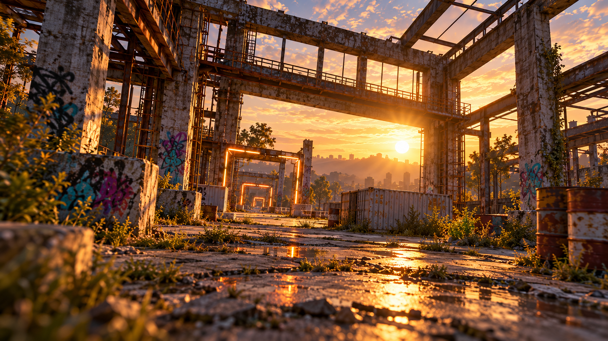

# AeroSim 1.0 场景美术交付

日期：2026-10-08。角色：环境美术。生成方式：内置 `image_gen`；新图生成（generate with references），不是修改原概念图、不是 CLI / API-key 路径。

## 交付资产

- 仓库路径：`assets/v1-art/environment/fpv-industrial-sunset-hero-v1.png`
- 原始生成文件：`/Users/bytedance/.codex/generated_images/01a11ec9-7f29-7db1-abce-43fca87c758f/exec-08f23736-7efc-4ea0-91d5-e1a06e2aa728.png`
- 实际分辨率：1672 × 941，近似 16:9。并非 4K，未用插值放大冒充高清。
- SHA-256：`d07d9e4f432fccba8b2ae76befb42d51b8fb0be0914313837f9b3a46b8c1642f`
- 适用范围：FPV Home 06 的菜单背景、Industrial Sprint 07 的缩略图及任务 Brief 插画。
- 禁止用法：不得当作实际可飞行 3D 场景、HUD 截图、QA 完成证明或用它替换原23张验收参考。
- 集成建议：菜单使用保持宽高比的 cover 裁切；右侧按钮、底部机型卡与免责声明由真实 UI 单独绘制，不写进背景。任务缩略图使用左中赛门裁切，不把假字符贴到场景中。



## 原图参考与视觉检查

完整查看过 Aerial Home 03、FPV Home 06、Challenges 07、Race OSD 09。03 为沿海蓝绿日景，不能拿工业黄昏代替其沿海 hero；本次资产只针对 FPV 工业主题。

06、07、09 的共同场景语言为混凝土立柱、钢梁骨架、高架走道、夕阳、集装箱、废厂植被和带光源的方形赛门。06、09 仅作为环境及构图参考输入生成工具，原文件均保持不变。

生成后用 `view_image` 检查了工作区最终文件：

- 旧混凝土、锈钢、剥落漆层、集装箱细节可辨识；暖金天空与蓝灰阴影关系合理。
- 高架钢梁和中心偏左赛门保留原图场景特征；右半工业结构留作独立菜单图层。
- 没有烘焙 UI、文字、数字、品牌标记、水印或 HUD。
- 无径向运动模糊；最靠近镜头的前景有轻微景深，主体和远处赛门清晰。
- 仅是相似场景语言的新资产，不声称与原概念图的所有环境像素相同。与原06的镜头倾斜、柱位及太阳位置存在差异，实际 UI 视觉验收须仍然对原06进行。

## 可执行的 3D 美术 Brief（尚未制作或验证）

用于后续原生 Unity 场景搭建，不能把以下建议计为已完成：

| 层级 | 实现建议 | 验证 |
| --- | --- | --- |
| 主要结构 | 米制白盒先固定赛道；混凝土柱约 0.7–1.0 m 截面、高约 8–12 m；钢梁与走道保持可通行间距 | 飞行路线与碰撞体检查，尺寸只是建议而非真实建筑测量 |
| 材质 | 混凝土灰基色、低金属度、较高粗糙度；钢梁暴露金属与锈蚀分层；集装箱波纹形状使用网格或法线 | 不把明暗烘焙进通用 albedo，检查近景重复纹理 |
| 赛门 | 方形网格与独立发光边；碰撞框与穿越触发体分离；橙色强调 | 飞行触发、碰撞与积分不是静态图片模拟 |
| 灯光 | 低角度暖向光、蓝灰环境光；阴影与适量 bloom；日落雾只帮助层次，不挡路线 | 原09固定机位对比后，再验证运动中的暴露与可读性 |
| 细节 | 草丛、裂缝、锈蚀、碎石作为稀疏实例；远处轮廓用低 LOD | 不为美术破坏无人机飞行空间；目标 Mac 帧率实测 |
| 资源边界 | 本次 PNG 只作菜单 / Brief；若要 3D PBR 材质需要单独创建 tileable albedo / normal / roughness 素材 | 未交付的法线、粗糙度、3D 网格、实机场景一律不得标为完成 |

## 最终 Prompt（原样记录）

```text
Use case: photorealistic-natural
Asset type: high-resolution wide landscape game menu hero/background and FPV mission briefing illustration, not a screenshot and not a UI mockup.
Primary request: Generate a NEW clean high-detail 16:9 scene of an abandoned American industrial concrete and steel-frame factory at warm golden sunset, for an FPV drone training simulator.
Input images: Images 1 (FPV Home) and 2 (FPV Race OSD) are STYLE AND ENVIRONMENT REFERENCES ONLY, not edit targets. Extract the environmental visual language; do not reproduce any interface, text, framing overlays, or telemetry.
Scene/backdrop: weathered concrete columns, exposed rusted steel roof beams, a high overhead catwalk across the yard, open roof to peach-gold sky, a white worn shipping container and a few rusted barrels alongside a cracked concrete path; restrained grass and weeds in cracks; warm glowing FPV square race gates set deeper in the center-left route.
Style/medium: realistic high-end game environment photography/render, physically believable industrial scale, detailed concrete aggregate, oxidized steel, chipped paint, natural wear.
Composition/framing: wide 16:9 landscape establishing shot from low FPV camera height facing diagonally through the old industrial framework toward the low sun and distant haze. Preserve a clear center route and broad scene readable at small thumbnail size. Left-center environment carries detail; right side has slightly simpler industrial structure so separate menu controls can be layered over it. Do not bake dark UI gradients into the image.
Lighting/mood: warm orange-gold low sunset streaming through beams, natural contact shadows, muted blue-gray concrete in shadow, mild atmospheric haze, controlled exposure with textured sky. Sharp fine detail, no motion blur or lens smearing.
Text (verbatim): none.
Constraints: no drones, people, brand marks, interface controls, HUD, captions, numbers, typography, signs, chevrons, watermarks or borders. Do not generate a replacement concept design; produce only a clean environment background asset. Maximum practical resolution and fine detail.
```
